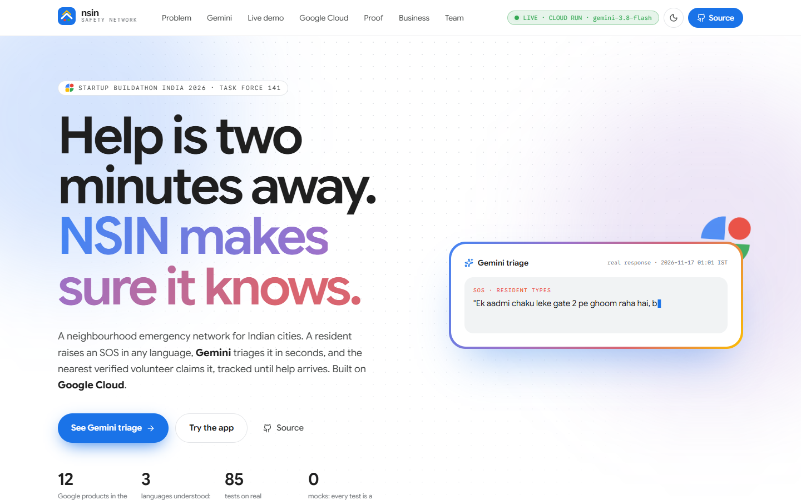
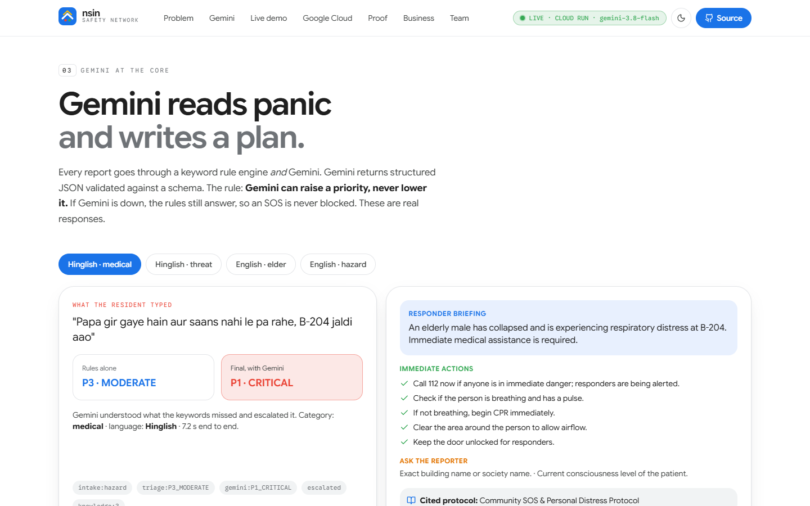
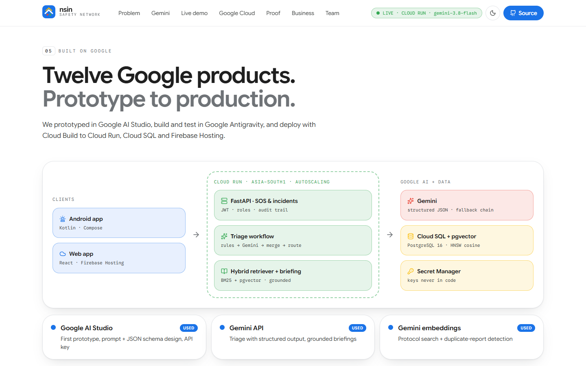

<div align="center">


# NSIN · the Google Cloud site

**Help is two minutes away. NSIN makes sure it knows.**

The public website for **NSIN (Neighbourhood Safety Intelligence Network)**, Team Task Force 141's entry for **Startup Buildathon India 2026**.
It explains the product, shows **real Gemini triage responses**, and runs the **real NSIN web app** at `/app/` against the API on **Cloud Run**.

[Code repo](https://github.com/YagnikSharma/Task_Force_141_Google_Startup_Buildathon_India_2026) ·
[Google Cloud setup guide](https://github.com/YagnikSharma/Task_Force_141_Google_Startup_Buildathon_India_2026/blob/main/docs/GOOGLE_CLOUD_SETUP.md)



</div>

## What's on the page
| Section | What it shows |
|---|---|
| **Hero** | A real Hinglish SOS being typed, and how the rules (P3) and Gemini (P1, escalated) each read it |
| **Gemini at the core** | Four real triage responses: the briefing, actions, missing details and the cited protocol. Gemini can raise a priority, never lower it |
| **Live demo** | The actual web app in a phone or desktop frame, talking to Cloud Run |
| **Built on Google** | The architecture (Cloud Run, Cloud SQL + pgvector, Gemini, Secret Manager) and 12 Google products, each marked used / deploy / planned |
| **Proof** | Test and scan results, plus recorded API responses (briefing, protocol search, analytics, health) |
| **Business and team** | Pricing, the competitor comparison and the three founders |




## How it stays honest
- `src/data/recorded.json` holds **real responses** from the NSIN API running with the real Gemini API and PostgreSQL + pgvector. They are never hand-edited. Re-record them with `node scripts/record-google.mjs src/data/recorded.json` against a running backend.
- `public/live.json` is filled in at deploy time with the Cloud Run URL. When it is empty or the API is unreachable, the pill reads **RECORDED MODE** and the page shows the recorded responses.

## Run locally
```bash
npm install
bash scripts/build-app.sh      # builds the real web app (from the code repo) into public/app/
npm run dev                    # http://localhost:5173
```

## Deploy to Firebase Hosting
Deploy the API first (code repo: `bash deploy/setup.sh && bash deploy/deploy.sh`). Then, in Google Cloud Shell:
```bash
git clone https://github.com/YagnikSharma/nsin-google-landing.git && cd nsin-google-landing
firebase login --no-localhost     # first time only
bash deploy.sh                    # builds the site, writes live.json with the Cloud Run URL, deploys
```
It is live at `https://<project-id>.web.app`, with the app at `/app/`.

## Stack
React 18 · TypeScript · Vite · Tailwind CSS v4 · Motion · lucide-react · Google Sans Flex. Hosted on **Firebase Hosting**.
